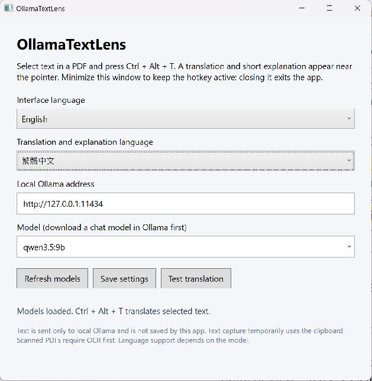
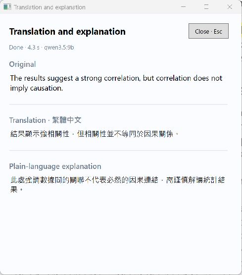
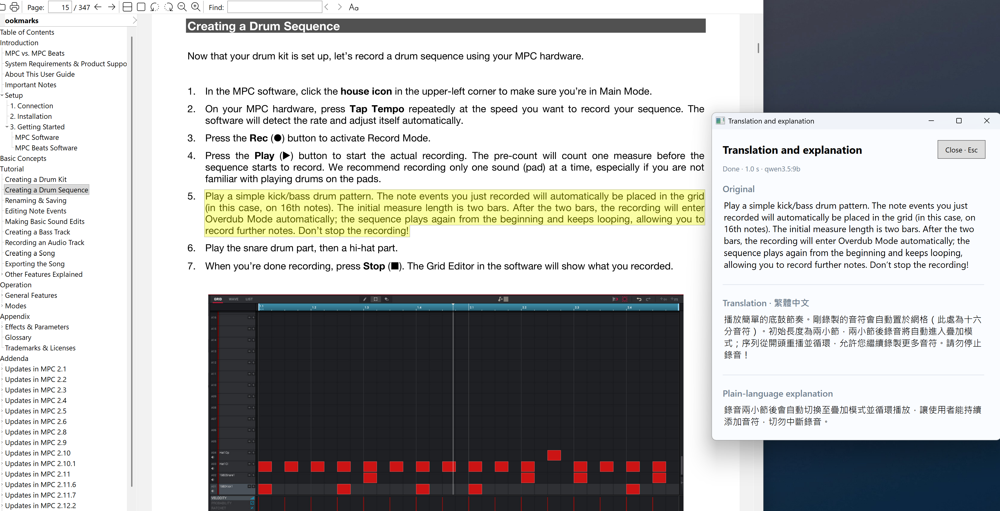
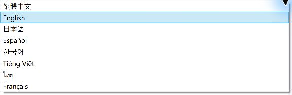

# OllamaTextLens

Select text, press **Ctrl + Alt + T**, and read the translation and a short explanation beside your pointer. OllamaTextLens is a Windows desktop app powered by local Ollama models, designed for reading PDFs with selectable text.

## Features

- Floating window with separate sections for the original text, translation, and explanation.
- Streaming responses and concise explanations in one or two sentences.
- Independent settings for interface language and translation language.
- Local Ollama connection, with no reading history saved by the app.

## Screenshots

The screenshots show the multilingual interface available in v0.2.0.

| Settings | Floating translation |
| --- | --- |
| Choose the interface language, target language, and local model. | Compare the original text with its translation and a short explanation. |
|  |  |

## Download and setup

1. Download the Windows x64 EXE or ZIP from [Releases](https://github.com/turkeyphage/OllamaTextLens/releases). Release builds include the .NET runtime.
2. Install and start [Ollama](https://ollama.com/), then download a **local chat model** that supports your source and target languages. Ollama and model weights are not bundled with this app.
3. Open OllamaTextLens. Keep the default address, `http://127.0.0.1:11434`, unless your local server uses another port.
4. Refresh the model list, choose your model and language settings, and select **Save settings**. Use **Test translation** to check the connection.

Multilingual settings are available in **v0.2.0 and later**. Older v0.1.0 builds have a Traditional Chinese interface and output.

## Usage

1. Select copyable text in your PDF reader.
2. Press **Ctrl + Alt + T**, then release the keys.
3. Read the original text, translation, and explanation in the floating window. Scroll or resize it as needed, and select text to copy it.

### In use: reading a PDF



Select a passage in your PDF reader and press **Ctrl + Alt + T**. The floating window displays the selected original text, its translation, and a concise explanation alongside the document. This example uses an English interface with Traditional Chinese output generated by a local Ollama model.

Close the floating window, or press **Esc** while it has focus, to stop the request and hide it. Minimize the main window to keep the shortcut active. Closing the main window exits the app.

## Languages

The interface supports **Traditional Chinese, English, Japanese, Spanish, Korean, Vietnamese, Thai, and French**.



The translation language is a separate setting. It supports those eight languages plus Simplified Chinese, German, Portuguese, Italian, and Indonesian. Ollama detects the source language and generates both the translation and explanation in the selected target language. Available language quality depends on the model.

Both settings default to Traditional Chinese. Existing model and connection settings remain compatible.

## Privacy and limitations

- Use a local Ollama model. The app connects only to a local HTTP endpoint and does not save source text, translations, or reading history. Ollama manages its own logs and model behavior.
- Text capture temporarily uses the clipboard and attempts to restore its previous contents. Some clipboard formats may not restore correctly.
- Scanned PDFs require OCR before use; OCR is not included. Protected PDFs may prevent copying.
- Run the PDF reader and OllamaTextLens at the same privilege level. Text order in multi-column PDFs depends on the reader.
- Selections are limited to 12,000 characters. Initial model loading can be slow; requests time out after five minutes.
- Settings are stored in `%LOCALAPPDATA%\OllamaTextLens\settings.json`.

## Development

Requires Windows and the .NET 10 SDK.

```powershell
dotnet build OllamaTextLens.csproj -c Release
dotnet run --project OllamaTextLens.csproj
dotnet run --project tests/Smoke.csproj -c Release
```

Tests use simulated Ollama responses; no model is required. GitHub Actions builds and tests source changes, then creates a self-contained EXE, ZIP, and SHA256 checksums for version-tagged releases. Build outputs and local logs are excluded from Git.
