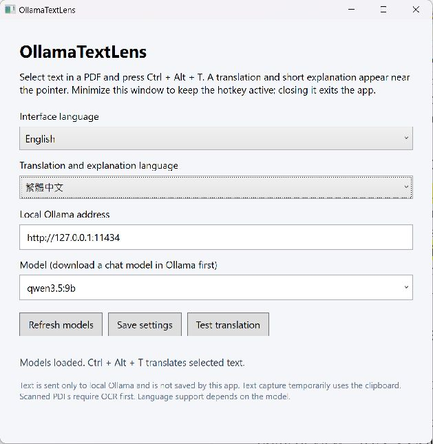
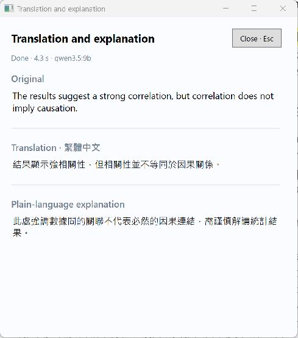
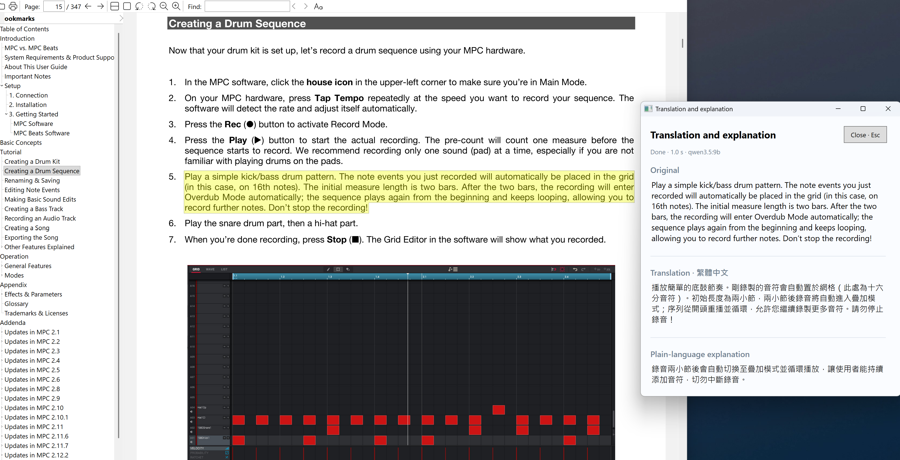
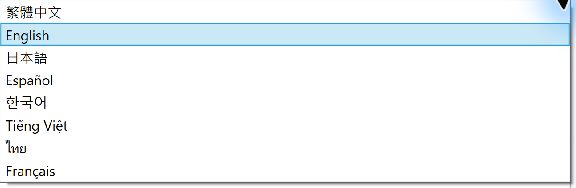

# OllamaTextLens


Select text, press **Ctrl + Alt + T**, and read the translation and a short explanation beside your pointer. OllamaTextLens is a Windows desktop app powered by local Ollama models, designed for reading PDFs with selectable text.

## Features

- Floating window with separate sections for the original text, translation, and explanation.
- Highlight-yellow app branding, with a separate simplified system tray icon and multi-size window icons.
- Streaming responses and concise explanations in one or two sentences.
- Offline English, Spanish and Japanese read-aloud with Kokoro: local language detection, manual language selection, male/female voices, play, pause/resume, stop, and 0.75–2× reading speed. Available in v0.2.5 and later.
- Independent settings for interface language and translation language.
- Live Ollama connection status and loaded models, refreshed every five seconds while settings are visible. The selected translation model is displayed separately; an idle server with no loaded models still shows as connected.
- Local Ollama connection, with no reading history saved by the app.

## Screenshots

The screenshots show the multilingual interface available in v0.2.0.

| Settings | Floating translation |
| --- | --- |
| Choose the interface language, target language, and local model. | Compare the original text with its translation and a short explanation. |
|  |  |

## Download and setup

1. Download the Windows x64 EXE or ZIP from [Releases](https://github.com/turkeyphage/OllamaTextLens/releases). Release builds include the .NET runtime.
2. Install and start [Ollama](https://ollama.com/), then download a **local chat model** that supports your source and target languages. Ollama and model weights are not bundled with this app.
3. Open OllamaTextLens. Keep the default address, `http://127.0.0.1:11434`, unless your local server uses another port.
4. Refresh the model list, choose your model and language settings, and select **Save settings**. Use **Test translation** to check the connection.

Multilingual settings are available in **v0.2.0 and later**. Older v0.1.0 builds have a Traditional Chinese interface and output.

## Usage

1. Select copyable text in your PDF reader.
2. Press **Ctrl + Alt + T**, then release the keys.
3. Read the original text, translation, and explanation in the floating window. Scroll or resize it as needed, and select text to copy it.

### In use: reading a PDF



Select a passage in your PDF reader and press **Ctrl + Alt + T**. The floating window displays the selected original text, its translation, and a concise explanation alongside the document. This example uses an English interface with Traditional Chinese output generated by a local Ollama model.

Close the floating window, or press **Esc** while it has focus, to stop the request and hide it. Starting with v0.2.3, closing the main settings window keeps OllamaTextLens running in the Windows system tray with its translation shortcut active. Double-click the tray icon, or right-click and choose **Open settings**, to reopen the window. Choose **Exit** from the tray menu to stop translations, unregister the shortcut, and fully exit the app. The tray icon may be in the hidden-icons menu beside the clock.

Starting with v0.2.1, only one instance runs per Windows user and session. Opening OllamaTextLens again closes the previous instance before the new window opens, cancelling any active translation. Unsaved settings are discarded; saved settings are retained. If the previous instance cannot exit, the new launch stops and asks you to close it first.

When upgrading from pre-0.2.1 releases, the app also closes matching older processes. A verified older release that remains in the background after its window closes is terminated so it cannot remain as a duplicate process.

## Local English, Spanish and Japanese speech

Settings checks whether the speech model is installed and complete. If it is missing or incomplete, read-aloud controls and voice tests are disabled; choose **Download speech model** to install it explicitly. You can cancel the download. Once ready, use **Test English voice** or **Test Spanish voice** without Ollama, or select PDF text as usual. Beside **Original**, use **Read aloud**, **Pause / Resume**, and **Stop**. English voices are Heart (female) and Michael (male); Spanish voices are Dora (female) and Alex (male). Voice and speed changes apply to the next playback. All six voices share the same downloaded model. Closing the popup or selecting a new passage stops audio.

**Source language** defaults to **Auto detect**. NTextCat identifies the language entirely on the device, then the app selects the corresponding Kokoro pronunciation frontend and voices. You can override it with **English** or **Español**, independently of interface and translation languages. Short selections, uncertain results, and unsupported languages require a manual choice. Detection can still be wrong, especially with mixed languages; this preview reads each selection in one language.

Japanese is also available with **日本語**, **Alpha** (female) and **Kumo** (male). Text containing Japanese kana is detected locally; kanji-only fragments require a manual choice to avoid confusing them with Chinese. Settings includes **Test Japanese voice** without an Ollama connection. Stop cancels generation; restarting launches the helper again when needed. All three languages retain pause/resume and speed selection.

Keep the entire `speech-ja` folder beside the EXE. This packaged Japanese component includes its own runtime and pronunciation dictionary, so Python does not need to be installed on the computer running the app. If it is missing, Japanese playback is disabled with an explanation; English and Spanish remain available. It reuses the installed Kokoro model and never downloads anything during playback. Build the helper with `./scripts/build-japanese-speech.ps1` using the environment prepared by `./scripts/test-kokoro-japanese.ps1`, then build the app normally. The test build preserves this folder. Japanese runs as a local helper process and closes with the app; source text and generated audio are passed through private pipes rather than saved to disk.

Speech runs on the CPU using quantized Kokoro v1.0. Downloading the speech model retrieves a pinned archive (about 126 MiB) from the official sherpa-onnx release and verifies its SHA256. Later playback and language identification are offline: no subscription, API key, usage charges, or text upload. The speech model is cached under `%LOCALAPPDATA%\OllamaTextLens\speech`, separate from Ollama models. Initialization and generation may take a few seconds; hardware affects latency.

Speech dependencies retain their own licenses; see [third-party notices](THIRD-PARTY-NOTICES.md). The model archive and its data are retained with their upstream license files.

## Languages

The interface supports **Traditional Chinese, English, Japanese, Spanish, Korean, Vietnamese, Thai, and French**.



The translation language is a separate setting. It supports those eight languages plus Simplified Chinese, German, Portuguese, Italian, and Indonesian. Ollama detects the source language and generates both the translation and explanation in the selected target language. Available language quality depends on the model.

Both settings default to Traditional Chinese. Existing model and connection settings remain compatible.

## Privacy and limitations

- Use a local Ollama model. The app connects only to a local HTTP endpoint and does not save source text, translations, or reading history. Ollama manages its own logs and model behavior.
- Text capture temporarily uses the clipboard and attempts to restore its previous contents. Some clipboard formats may not restore correctly.
- Scanned PDFs require OCR before use; OCR is not included. Protected PDFs may prevent copying.
- Run the PDF reader and OllamaTextLens at the same privilege level. Text order in multi-column PDFs depends on the reader.
- Selections are limited to 12,000 characters. Initial model loading can be slow; requests time out after five minutes.
- Settings are stored in `%LOCALAPPDATA%\OllamaTextLens\settings.json`.

Download the full release ZIP for Japanese support; the separate EXE needs the accompanying `speech-ja` folder for Japanese.

## Development

Requires Windows and the .NET 10 SDK.

```powershell
dotnet build OllamaTextLens.csproj -c Release
dotnet run --project OllamaTextLens.csproj
dotnet run --project tests/Smoke.csproj -c Release
```

For local preview builds, run `./scripts/build-test.ps1`. It always writes to `artifacts/test`; exit the running app from its tray menu before rebuilding. Keep the generated files together when running `artifacts/test/OllamaTextLens.exe`.

Tests use simulated Ollama responses; no model is required. GitHub Actions builds and tests source changes, then creates a self-contained EXE, ZIP, and SHA256 checksums for version-tagged releases. Build outputs and local logs are excluded from Git.

## License

OllamaTextLens source code is licensed under the [MIT License](LICENSE).

Third-party document content shown in screenshots remains the property of its respective copyright holders. Ollama and downloaded models have their own licenses.
